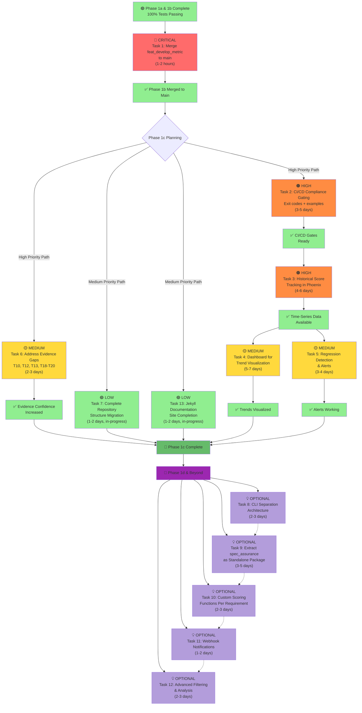
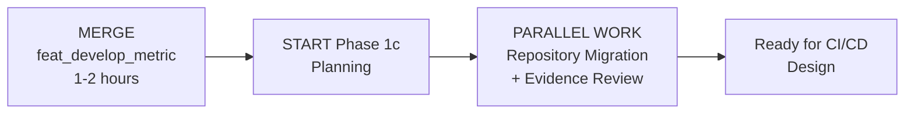
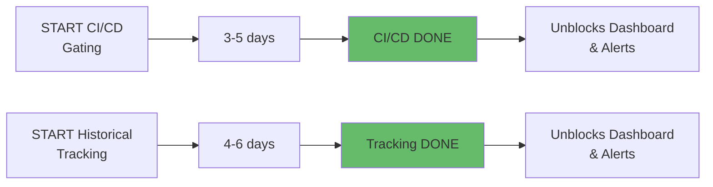
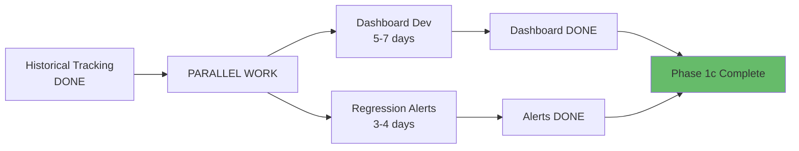

# Phase 1c & Beyond: Dependency Flow Diagram

**Purpose:** Visualize task dependencies to plan Phase 1c work sequencing  
**Date Generated:** 19 November 2026  
**Scope:** All 13 outstanding tasks with prioritization and blocking relationships

---

## Task Dependency Flow



---

## Critical Path Analysis

### **Week 1: Merge & Initial Setup**



**Duration:** ~1 week  
**Deliverables:**
- Code merged to main
- Phase 1c timeline approved
- Evidence gaps identified

---

### **Week 2-3: High-Priority Features**



**Duration:** 2-3 weeks  
**Deliverables:**
- Exit codes working
- CI/CD examples (GitHub Actions, GitLab, Jenkins)
- Phoenix experiments created automatically
- Historical data persisting

---

### **Week 4-5: Dashboard & Alerts**



**Duration:** 1-2 weeks  
**Deliverables:**
- Dashboard deployed
- Trend visualization working
- Regression alerts configured
- Notifications working

---

## Dependency Matrix

| Task | Depends On | Blocks | Priority | Effort |
|------|-----------|--------|----------|--------|
| 1. Merge to main | None | All Phase 1c | 🔴 Critical | 1-2h |
| 2. CI/CD Gating | Merge | Historical tracking | 🟠 High | 3-5d |
| 3. Historical Tracking | CI/CD Gating | Dashboard, Alerts | 🟠 High | 4-6d |
| 4. Dashboard | Historical Tracking | None (optional) | 🟡 Medium | 5-7d |
| 5. Regression Alerts | Historical Tracking | None (optional) | 🟡 Medium | 3-4d |
| 6. Evidence Gaps | None | None (QA review) | 🟡 Medium | 2-3d |
| 7. Repository Migration | None | None (in-progress) | 🟢 Low | 1-2d |
| 8. CLI Separation | Phase 1c stable | Phase 2 work | 💡 Future | 2-3d |
| 9. Extract Tool | Stabilize design | Phase 2 work | 💡 Future | 3-5d |
| 10. Custom Scoring | Phase 1c stable | Phase 2 work | 💡 Future | 2-3d |
| 11. Webhooks | Phase 1c stable | Phase 2 work | 💡 Future | 1-2d |
| 12. Advanced Analysis | Phase 1c stable | Phase 2 work | 💡 Future | 2-3d |
| 13. Jekyll Site | None | None (in-progress) | 🟢 Low | 1-2d |

---

## Parallel Work Opportunities

### **Can Start Immediately After Merge:**

```
┌─ Task 6: Evidence Gaps Review (independent)
├─ Task 7: Repository Migration (independent)
└─ Task 13: Jekyll Site Completion (independent)
```

**Total effort:** ~4-7 days (can run parallel)  
**Risk:** None; unblocks nothing but improves code quality

---

### **Can Start After CI/CD Planning:**

```
Task 2: CI/CD Gating (3-5 days)
   ↓
Task 3: Historical Tracking (4-6 days) 
   ↓
├─ Task 4: Dashboard (5-7 days) [parallel]
└─ Task 5: Regression Alerts (3-4 days) [parallel]
```

**Total critical path:** ~11-15 days  
**Parallel opportunities:** Dashboard + Alerts can run together

---

## Resource Allocation Scenarios

### **Scenario A: Small Team (1-2 people)**

```
Week 1:  Merge + Evidence Review
Week 2:  CI/CD Gating
Week 3:  Historical Tracking
Week 4-5: Dashboard + Alerts (sequential)
Timeline: 5 weeks
```

### **Scenario B: Medium Team (3-4 people)**

```
Week 1:  Merge + Evidence Review + Repository Migration
Week 2:  CI/CD Gating + Jekyll Site
Week 3:  Historical Tracking
Week 4:  Dashboard + Alerts (parallel)
Timeline: 4 weeks
```

### **Scenario C: Large Team (5+ people)**

```
Week 1:  All independent tasks (merge, evidence, migration, jekyll)
Week 2:  CI/CD Gating + planning infrastructure
Week 3:  Historical Tracking (parallel with other work)
Week 4:  Dashboard + Alerts (parallel)
Timeline: 3-4 weeks
```

---

## Risk & Mitigation

| Risk | Probability | Impact | Mitigation |
|------|-------------|--------|-----------|
| Evidence gaps larger than expected | Medium | Medium | Review all 6 requirements early; allocate 3-4 days |
| Phoenix integration complexity | Low | High | Spike on Phoenix API; test with simple experiment first |
| Dashboard performance issues | Low | Medium | Use materialized views; test with realistic data volumes |
| Regression alert false positives | Medium | Medium | Establish thresholds early; tune based on real data |
| Team availability conflicts | Medium | Medium | Confirm team capacity before Phase 1c kickoff |

---

## Decision Points

### **Decision 1: Merge Timing** ✅
- **Decision:** Merge immediately after code review
- **Blockers removed:** 0 (already clear)
- **Recommended:** YES

### **Decision 2: CI/CD Platform Support**
- **Options:**
  - Option A: GitHub Actions only (simplest)
  - Option B: GitHub Actions + GitLab CI (most common)
  - Option C: GitHub + GitLab + Jenkins (complete)
- **Recommendation:** Start with A, add B in Phase 1c if needed
- **Timeline impact:** Each platform adds ~1 day

### **Decision 3: Historical Tracking Scope**
- **Options:**
  - Option A: Per-requirement results only (minimal)
  - Option B: Per-requirement + raw test outcomes (recommended)
  - Option C: Include performance metrics (advanced)
- **Recommendation:** Option B (best ROI)
- **Timeline impact:** A=3d, B=5d, C=7d

### **Decision 4: Dashboard Implementation**
- **Options:**
  - Option A: Static HTML exports (simple)
  - Option B: Interactive Phoenix dashboard (recommended)
  - Option C: Custom web app (complex)
- **Recommendation:** Option B
- **Timeline impact:** A=2d, B=6d, C=10d

### **Decision 5: Extraction Timeline**
- **Options:**
  - Option A: Extract now (risky)
  - Option B: Extract after Phase 1c (recommended)
  - Option C: Extract only if requested (minimal risk)
- **Recommendation:** Option B
- **Rationale:** Design needs stabilization; not blocking current work

---

## Success Metrics

### **Phase 1c Completion Checklist**

- [ ] `feat_develop_metric` merged to main
- [ ] CI/CD gating exits codes working (exit 0, 1, 2)
- [ ] At least 2 CI/CD examples documented and tested
- [ ] Historical scores stored in Phoenix after every test run
- [ ] Dashboard showing trend visualization
- [ ] Regression detection flagging score decreases
- [ ] Evidence gaps for T10, T12, T13, T18-T20 addressed
- [ ] Repository migration completed
- [ ] Jekyll documentation site deployed
- [ ] Zero regressions in existing tests
- [ ] Team trained on all new features

**Timeline:** 2-4 weeks (depending on team size and priorities)  
**Effort:** ~30-45 person-days total

---

## Next Steps

1. ✅ Approve merge of `feat_develop_metric`
2. ⏳ Confirm Phase 1c team and capacity
3. ⏳ Review and approve CI/CD gating design
4. ⏳ Prioritize Phase 1c scope (all vs. CI/CD + tracking only)
5. ⏳ Schedule Phase 1c kickoff meeting
6. ⏳ Assign tasks based on team availability

---

**Generated:** 19 November 2026  
**Author:** Copilot  
**Purpose:** Dependency visualization for Phase 1c planning
